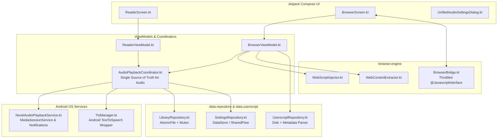

# AI Agent & Contributor Engineering Guidelines

> **Target Audience**: AI Coding Agents (LLMs) and human contributors modifying or extending the **NovelArrow Reader TTS** codebase.
> **Primary Rule**: Read and strictly adhere to these architectural contracts before proposing or implementing changes.

---

## 1. Architectural Overview & Philosophy

NovelArrow Reader TTS is built with **Modern Android Architecture (MVVM)**, **Jetpack Compose (Material 3)**, **AndroidX Media3**, **Android Native Text-To-Speech (TTS)**, and an extensible **Userscript Web Engine**.



### Core Principles
1. **Single Source of Truth (SSOT)**: State is owned by a single dedicated manager. Never duplicate state across multiple ViewModels or Services.
2. **Unidirectional Data Flow (UDF)**: ViewModels emit immutable `StateFlow<UiState>` to Composables. User actions flow up as intents/function calls. One-off side effects (navigation, web commands, toasts) use buffered `Channel` / `Flow`.
3. **Zero Context Leaks**: Never retain Android `Context`, `Activity`, `View`, or `WebView` references inside ViewModels, singletons, or coroutines outliving the UI lifecycle.
4. **Thread Isolation**: All file I/O, heavy JSON parsing, DOM extraction, and database access MUST run on `Dispatchers.IO`. The main thread is reserved for UI rendering and UI event dispatching.

---

## 2. Subsystem Enforcement Rules

### A. Audio Subsystem (`com.novelarrow.reader.playback`)

The audio subsystem coordinates Text-to-Speech playback across both local book chapters and live web novel pages.

* **Single Entry Point**: All audio playback commands (`play()`, `pause()`, `seekToParagraph()`, `nextParagraph()`, `nextChapter()`, speed adjustments, sleep timer) MUST go through [`AudioPlaybackCoordinator`](file:///android-app/app/src/main/java/com/novelarrow/reader/playback/AudioPlaybackCoordinator.kt).
* **Do NOT manage TTS in ViewModels**: Neither `ReaderViewModel` nor `BrowserViewModel` may directly instantiate or call `TtsManager`. They must observe `AudioPlaybackCoordinator.playbackProgressState`.
* **Lean Foreground Service**: [`NovelAudioPlaybackService`](file:///android-app/app/src/main/java/com/novelarrow/reader/playback/NovelAudioPlaybackService.kt) is strictly a Media3 background worker and notification host. It delegates playback state, queue orchestration, and next/previous logic to `AudioPlaybackCoordinator`.
* **Audio Focus & Loudspeaker Protection**: The service must immediately pause upon `AUDIO_BECOMING_NOISY` (e.g. unplugging headphones) or when losing audio focus. Never remove or bypass noisy broadcast receivers.
* **TtsManager Chunking & Safe Locales**: `TtsManager` must chunk long paragraphs into sentences (<3800 chars) honoring quotation marks and CJK punctuation without splitting dialogue. Always handle language fallbacks cleanly if a requested voice or locale is missing on the user's device.

### B. Browser Engine & Userscript System (`com.novelarrow.reader.browser.engine` & `com.novelarrow.reader.data.userscript`)

The browser subsystem allows live in-browser TTS reading, batch chapter scraping, and custom userscript execution.

* **No Raw JavaScript in ViewModels or UI**: Never embed multi-line JavaScript string templates inside `BrowserViewModel.kt` or `BrowserScreen.kt`. All JavaScript logic belongs in:
  - [`WebScriptInjector.kt`](file:///android-app/app/src/main/java/com/novelarrow/reader/browser/engine/WebScriptInjector.kt) (injection code, highlight scripts, next chapter clickers, CSS styling, Userscript wrapping).
  - [`WebContentExtractor.kt`](file:///android-app/app/src/main/java/com/novelarrow/reader/browser/engine/WebContentExtractor.kt) (DOM text extraction, selector parsing, heading resolution).
* **Safe JavaScript Bridge ([`BrowserBridge.kt`](file:///android-app/app/src/main/java/com/novelarrow/reader/browser/engine/BrowserBridge.kt))**:
  - All `@JavascriptInterface` methods must be lightweight.
  - High-frequency events (such as scroll detection or DOM mutations) MUST be debounced (minimum 300–500ms) to prevent Android Binder transaction overflows (`TransactionTooLargeException`).
  - Bridge callbacks must be posted to `Handler(Looper.getMainLooper())` or a coroutine before triggering ViewModel actions.
* **Greasemonkey / Userscript Standards**:
  - Metadata parsing is governed by [`UserscriptMetadataParser.kt`](file:///android-app/app/src/main/java/com/novelarrow/reader/data/userscript/UserscriptMetadataParser.kt) supporting standard Tampermonkey/Violentmonkey headers (`@match`, `@include`, `@run-at`, `@grant`, `@name`, `@version`).
  - All scripts run inside isolated IIFEs with `try-catch` wrappers so broken scripts do not crash the WebView or halt subsequent script execution.
  - Exposed Greasemonkey APIs (such as `GM_notification`) must be polyfilled in `WebScriptInjector.buildHelperScript()` and routed through `BrowserBridge`.

### C. Data Persistence, Concurrency & Storage (`com.novelarrow.reader.data`)

* **Thread-Safe Repository State**: All read/write operations modifying repository state or files must be synchronized using a Kotlin `Mutex` (`mutex.withLock`).
* **Cache Coherency During Debounced Saves**: In repositories that debounce disk writes (such as [`LibraryRepository.kt`](file:///android-app/app/src/main/java/com/novelarrow/reader/data/repository/LibraryRepository.kt)), the in-memory cache (`@Volatile cachedDb`) MUST be updated immediately on modification. Intermediate reads during batch operations must never read stale uncommitted data from disk.
* **Atomic File Writes**: Critical JSON database files (`library_db.json`, `userscripts_db_v1.json`, preferences) MUST be written using `androidx.core.util.AtomicFile` or safe temporary-to-rename atomic operations to prevent zero-byte corruptions if the app process terminates mid-write.
* **Scoped Storage Compliance**: Always prioritize app-specific storage (`context.getExternalFilesDir()` / `context.filesDir`). When accessing shared external storage or folders, always handle permission fallbacks gracefully without crashing.

### D. UI & Jetpack Compose Standards (`com.novelarrow.reader.ui`)

* **WebView Lifecycle Teardown**: WebViews must be cleaned up in Compose using `DisposableEffect`:
  ```kotlin
  DisposableEffect(Unit) {
      onDispose {
          webViewInstance?.let { wv ->
              wv.stopLoading()
              wv.loadUrl("about:blank")
              wv.destroy()
          }
          webViewInstance = null
      }
  }
  ```
* **Decoupled Actions**: One-off UI commands for WebView (navigation, evaluating JavaScript, history back/forward) must be passed from the ViewModel via `Channel<BrowserAction>` exposed as `Flow<BrowserAction>`.
* **Unified Controls**: Shared settings (such as TTS speed, pitch, voice, pronunciation rules, skip words) must use [`UnifiedAudioSettingsDialog.kt`](file:///android-app/app/src/main/java/com/novelarrow/reader/ui/common/UnifiedAudioSettingsDialog.kt) rather than maintaining duplicate UI dialogs in Reader and Browser.

---

## 3. Strict Antipatterns (The "Do NOT" List)

| Antipattern | Why it is Forbidden | Correct Approach |
| :--- | :--- | :--- |
| **Direct TTS instantiation in UI/VM** | Causes competing TTS audio engines, audio stutter, and engine shutdown on screen exit | Use `AudioPlaybackCoordinator` for all audio commands and observe its StateFlow |
| **Storing WebView or View in ViewModel** | Causes massive memory leaks of Activity context on screen rotation or configuration changes | Use `Channel<BrowserAction>` / `Flow` to send commands down to Compose |
| **Unthrottled `@JavascriptInterface`** | Triggers Android Binder buffer exhaustion (`TransactionTooLargeException`) and UI freezes | Debounce events in `BrowserBridge` and dispatch to Main Looper |
| **Raw JS string templates in UI files** | Makes maintenance impossible and breaks Userscript modularity | Put all JS scripts in `WebScriptInjector` or `WebContentExtractor` |
| **Allocating `ToneGenerator` for clicks** | Causes native audio track resource exhaustion on rapid button presses | Use native Compose view sound effects or Android View haptics |
| **Direct disk I/O on Main thread** | Freezes the UI and causes Android Application Not Responding (ANR) | Always wrap I/O in `withContext(Dispatchers.IO)` |
| **Skipping in-memory cache on async DB save** | Causes data loss / library wipe when reading immediately after an async write | Update `@Volatile cachedDb` immediately on every change |

---

## 4. Testing & Verification Standards

* **Unit Tests Location**: All unit tests reside under `android-app/app/src/test/java/com/novelarrow/reader/`.
* **Mandatory Test Verification**:
  Before submitting any code changes, always run:
  ```bash
  cd android-app && ./gradlew testDebugUnitTest
  ```
  All tests must pass with exit code `0`.
* **When to Add Unit Tests**:
  - Any modifications to `ChapterParser` (splitting sentences, quotes, CJK punctuation, header/footer skips).
  - Any modifications to `WebScriptInjector` (URL pattern matching, script wrapping).
  - Any modifications to `UserscriptMetadataParser` or `UserscriptRepository`.
  - Any changes to library progress calculation, chapter sorting, or backup/restore serialization.

---

## 5. Version Bumping, Release Lifecycle & Signing Integrity

Whenever you finish adding a feature, refactoring, or fixing a bug, you **MUST increment the application version** and ensure signing key consistency before pushing.

### A. Semantic Versioning Rules
Select the version segment to increment based on the scope of changes:
* **MAJOR (`X.0.0`, e.g. `2.0.0` ➔ `3.0.0`)**: Breaking database migrations, complete framework migrations, or total architectural overhauls incompatible with prior versions.
* **MINOR (`x.Y.0`, e.g. `2.3.0` ➔ `2.4.0`)**: New user-facing features, new routes/screens (e.g. Global Settings, Reading Mode), new background services, or significant subsystem additions.
* **PATCH (`x.y.Z`, e.g. `2.4.0` ➔ `2.4.1`)**: Bug fixes, performance optimizations, string corrections, or minor UI tweaks.

> [!IMPORTANT]
> **Always increment `versionCode` by +1** (`versionCode = N + 1`). Android's Package Manager enforces strictly increasing `versionCode` values and will reject update installations if the `versionCode` is equal to or lower than the currently installed APK.

### B. Checklist: Files You Must Update on Every Version Increment
When bumping the version, you must update the following three files synchronously:

1. **`android-app/app/build.gradle.kts`**:
   - Increment `versionCode` (e.g. `versionCode = 9`).
   - Update fallback `appVersionName` (e.g. `.getOrElse("2.4.0")`).
2. **`.github/workflows/release.yml`**:
   - Update `DATE_TAG="v2.4.0"`
   - Update `APP_VERSION_NAME: "2.4.0"`
   - Update `run: ./gradlew assembleRelease -PappVersionName=2.4.0 --no-daemon`
   - Update `name: NovelArrow Reader v2.4.0 (Stable)`
   - Update the release markdown `body` summarizing the newly added features and bug fixes.
3. **`android-app/app/src/main/java/com/novelarrow/reader/data/updater/AppUpdateManager.kt`**:
   - Update the fallback version string in `getInstalledVersionName()`:
     ```kotlin
     pInfo.versionName ?: "2.4.0"
     ```

### C. Signature Integrity & Keystore Rules (No Signature Mismatches)

> [!WARNING]
> **Never allow signature drift across builds.** Android strictly prevents app updates if the installed APK and incoming APK were signed with different private keys (`INSTALL_FAILED_UPDATE_INCOMPATIBLE`).

* **Permanent Keystore**: The official signing key is permanently committed to git at:
  ```
  android-app/app/keystore/release.keystore
  ```
  - **Key Alias**: `novelarrow`
  - **Keystore & Key Password**: `novelarrow`
  - **SHA-256 Fingerprint**: `4E:A5:E2:A7:E5:CD:53:E7:84:7C:93:E5:4D:10:85:51:01:90:A9:26:A0:01:97:57:ED:E9:37:63:D7:97:6B:5E`
* **Identical Signing for Debug and Release**:
  In `android-app/app/build.gradle.kts`, **BOTH** `release` and `debug` build types MUST point to `signingConfigs.getByName("release")`:
  ```kotlin
  signingConfigs {
      create("release") {
          storeFile = file("keystore/release.keystore")
          storePassword = providers.environmentVariable("KEYSTORE_PASSWORD")
              .orElse(providers.gradleProperty("KEYSTORE_PASSWORD"))
              .getOrElse("novelarrow")
          keyAlias = providers.environmentVariable("KEY_ALIAS")
              .orElse(providers.gradleProperty("KEY_ALIAS"))
              .getOrElse("novelarrow")
          keyPassword = providers.environmentVariable("KEY_PASSWORD")
              .orElse(providers.gradleProperty("KEY_PASSWORD"))
              .getOrElse("novelarrow")
          enableV1Signing = true
          enableV2Signing = true
      }
  }

  buildTypes {
      release {
          isMinifyEnabled = false
          signingConfig = signingConfigs.getByName("release")
          proguardFiles(getDefaultProguardFile("proguard-android-optimize.txt"), "proguard-rules.pro")
      }
      debug {
          signingConfig = signingConfigs.getByName("release")
      }
  }
  ```
* **Why this matters**:
  If `debug` uses the default Android debug keystore (`~/.android/debug.keystore`), local development builds will have a different signature than GitHub Actions CI release builds. By binding `debug` to `release.keystore`, all APKs—whether built locally or downloaded from GitHub releases—share the exact same signature certificate and can update cleanly over each other without error.

