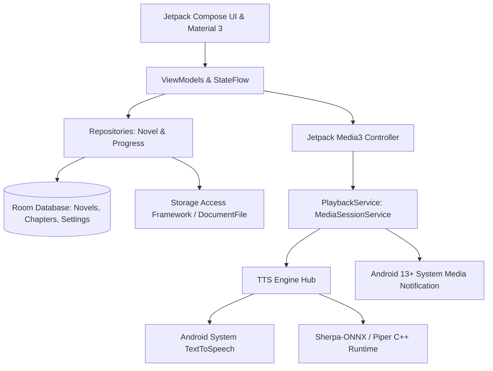

# Source Code Analysis & Native Android Migration Blueprint
**Source Project:** NovelArrow Reader Pro  
**Document Target:** Architecture Breakdown, Web Limitations, and Native Android Stack Proposal

---

## 1. Executive Summary & Source Project Overview

**NovelArrow Reader Pro** is a client-side, local-first web application designed for reading light novels, web novels, and episodic text files with real-time text-to-speech (TTS), visual highlighting, auto-advancing chapters, and audio recording.

### Key Pillars of the Source Application:
1. **Directory-as-a-Library Model:**
   - Users select a root folder. Every immediate subfolder is indexed as an independent playlist/novel.
   - Files within subfolders are naturally sorted (e.g., `Chapter 1`, `Chapter 2`, ..., `Chapter 10`).
   - Root-level loose files form a default fallback book playlist.
   - Supported extensions: `.txt`, `.md`, `.html`, `.xhtml`, `.xml`, `.json`, `.csv`, `.log`, `.rtf`.
2. **Dual-Engine TTS Architecture:**
   - **Piper Neural TTS:** Runs offline neural voice models (ONNX) in the browser via WebAssembly (`@mintplex-labs/piper-tts-web`), caching models (~63–114 MB) in Origin Private File System (OPFS).
   - **Device SpeechSynthesis:** Fallback using the browser/OS `window.speechSynthesis` API.
3. **Reading Experience & Dynamic Highlighting:**
   - Sandboxed HTML/Text rendering inside a Shadow DOM.
   - Paragraph and sentence-level text chunking (splitting sentences at punctuation for long paragraphs).
   - Real-time sentence/paragraph highlighting (`.na-tts-highlight`) with automatic smooth scrolling to keep the speaking cursor centered.
   - Double-tap on any paragraph to start speaking immediately from that location.
4. **Auto-Advancing & Looping:**
   - Automatically transitions to the next chapter when TTS completes or when the user scrolls to the bottom of the viewport.
   - Configurable countdown delay and loop limits.
5. **Audio Recording/Export:**
   - Can record TTS playback of single chapters or entire playlists into WebM audio files using `MediaRecorder` + tab audio capture.
6. **Web Workarounds for Mobile Backgrounding:**
   - Injects a looping, near-silent HTML5 `<audio>` track to prevent mobile browsers from freezing background JavaScript.
   - Employs a 10-second pause/resume watchdog cycle to work around browser `speechSynthesis` engine freeze bugs.
   - Utilizes Screen WakeLock API and `navigator.mediaSession` for lock-screen info.

---

## 2. In-Depth Source Code Breakdown

### A. Storage & State Management (`source/js/storage.js`)
- **Database Architecture:** Uses IndexedDB (`novelarrow-db`, v2) with two primary stores:
  - `handles`: Persists FileSystemDirectoryHandle and FileSystemFileHandle references (File System Access API).
  - `playlists`: Stores playlist metadata, chapter entries list, and per-chapter progress (`scrollTop`, `ttsIndex`, `completed` lists).
- **Settings & Session:**
  - Persisted in `localStorage` under `novelArrowReader::settings::v3`.
  - Stores reading preferences (theme: dark/sepia/light, font size), TTS engine (`auto`, `piper`, `device`), voice IDs, speed rate (0.5x–2.0x), auto-scroll toggle, auto-next on TTS completion, skip word lists, pronunciation regex replacement rules, and CSS selector filters.
- **Root Folder Registry:** Keeps a list of scanned root directory references in `localStorage` (`novelArrowReader::roots`) to enable multi-folder re-syncs.

### B. Library Management & Ingestion (`source/js/library.js`)
- **Folder Traversal:**
  - Uses `showDirectoryPicker` where supported; falls back to `<input type="file" webkitdirectory>` on unsupported browsers.
  - Recursively maps files within subdirectories.
  - Natural sorting (`naturalCompare`: `localeCompare` with `{ numeric: true, sensitivity: 'base' }`) ensures chapter order integrity.
- **State Merging & Re-Sync (`refreshRoot`):**
  - Allows rescanning on-disk folders to pick up newly added chapter files while retaining existing reading progress, completed chapter marks, and paragraph scroll positions for existing chapters by matching filename keys.
- **Chapter Loading & Navigation:**
  - `loadEntry(index)` pulls content from handle/file, passes raw text/HTML to renderer, restores scroll/TTS position, and updates navigation state.

### C. Text Parsing, Rendering & UI (`source/js/ui.js` & `source/style.css`)
- **Shadow DOM Isolation:** Attaches an open ShadowRoot to `#reader-content`. This isolates book styling, removes external script/stylesheet tags, strips link targets, and avoids leaking styles into the app shell.
- **Themes & Responsive Styles:**
  - Pure CSS variables for sleek dark theme (`--bg-0: #0b1020`), Sepia (`#f4ecd8`), and Light.
  - Floating Action Button (`fab-next`) appears near the bottom corner when chapters remain.
  - Slide-out navigation drawer with tabs for "Library" (books) and "Chapters" (playlist table of contents).
- **Scroll Synchronization:**
  - `attachScrollHandler` saves `scrollTop` with debounce (400ms).
  - Fires near-bottom auto-advance trigger when `scrollTop + clientHeight >= scrollHeight - 6`.

### D. Text-to-Speech Engine & Audio Pipeline (`source/js/tts.js` & `source/js/piper.js`)
- **Text Extraction & Sentence Splitting:**
  - Queries `p, h1, h2, h3, h4, h5, h6, li, blockquote, div` while ignoring navigation, headers, footers, ads, and user-specified CSS selectors.
  - Paragraphs over 240 characters are split into sentence spans (`.na-tts-sentence`) with punctuation delimiters (`[.!?。！？]`) to prevent TTS synthesis buffer overflows and ensure snappy playback.
  - Text cleanup: executes user pronunciation replacements (`ttsReplacements`) and word skips (`ttsSkipList`).
- **Piper Neural TTS Integration:**
  - Dynamically imports `@mintplex-labs/piper-tts-web@1.0.4`.
  - Downloads ONNX models (`en_US-libritts_r-medium`, `en_US-libritts-high`, `en_GB-aru-medium`) to OPFS with download progress tracking.
  - Synthesizes text blocks to WAV blobs, converted to object URLs, played through an HTML `<audio id="tts-audio">` element with a duration-based watchdog timer.
- **Web Background Audio Keepalive Hacks:**
  - Line 16 of `tts.js`: Plays `#silent-audio` (base64 1-sample silent WAV) on loop at volume `0.001` to trick mobile operating systems into keeping the browser tab alive.
  - Line 349 of `tts.js`: Sets a 10-second interval running `speechSynthesis.pause(); speechSynthesis.resume();` because mobile Chrome pauses speech synthesis after ~15 seconds of inactivity or backgrounding.
  - MediaSession API handlers (`play`, `pause`, `previoustrack`, `nexttrack`, `stop`) update lock-screen metadata with a canvas-generated album art.

---

## 3. Web Flaws & Why Android Native is Dramatically Superior

| Feature / Concern | Web Implementation (Source) | Native Android (Target App) |
| :--- | :--- | :--- |
| **Background Playback** | Relies on silent audio loop hack; frequently killed by OS battery optimization. | True **Foreground Service** with `mediaPlayback` type; runs indefinitely with screen off. |
| **Notification Controls** | Basic MediaSession API; often dropped by browser; lacks standard seek bar and custom actions. | Native **Media3 Notification** integrated with Android 13+ system media player carousel. |
| **File Access / Storage** | Ephemeral file handles; frequent permission prompts on mobile Chrome. | **Storage Access Framework (SAF)** with persistable URI permissions; instant re-access across reboots. |
| **Piper Neural TTS** | Heavy WASM/ONNX runtime inside Web Worker; slow inference, battery drain, device heating. | Native **C++ ONNX Runtime / Sherpa-ONNX** with ARM NEON SIMD; ~5–10x faster inference, minimal battery load. |
| **System TTS** | Inconsistent `window.speechSynthesis` voices; browser-dependent; no per-word offset callback. | Native `android.speech.tts.TextToSpeech` with full engine support (Google TTS, Samsung, Vocalizer) and `UtteranceProgressListener`. |
| **Audio Focus** | Tab audio overrides other apps or gets abruptly muted; no proper phone call handling. | Automatic **Audio Focus** management via Media3 (pauses on calls, ducks for navigation alerts). |
| **Hardware Keys** | Limited Bluetooth / headset button handling. | Full AVRCP hardware headset media buttons (single click: play/pause, double click: next, etc.). |

---

## 4. Recommended Native Android Tech Stack



### A. Core Platform & Architecture
- **Language:** Kotlin (100% modern coroutines, structured concurrency, flows).
- **Architecture Pattern:** Clean Architecture + MVI/MVVM with Unidirectional Data Flow (UDF).
- **Dependency Injection:** Hilt / Dagger (standard for Android media services).
- **Local Persistence:**
  - **Room Database:** Manages tables for Novels, Chapters, Reading Progress, TTS Pronunciation Rules, and Skip Words.
  - **Jetpack DataStore Preferences:** For reactive settings (theme, font size, active voice, playback speed).
- **Storage / File Management:**
  - Android Storage Access Framework (`ActivityResultContracts.OpenDocumentTree`).
  - Calls `contentResolver.takePersistableUriPermission()` so the app never loses folder access.
  - DocumentFile API for directory traversal and file stream ingestion.

### B. UI & Reader Layer
- **Jetpack Compose (Material 3):**
  - Edge-to-edge support (`enableEdgeToEdge()`) respecting system bars, cutouts, and gestures.
  - Reader View implemented with Compose `LazyColumn` or Compose Text Layout with paragraph keys.
  - Dynamic scrolling: `LazyListState.animateScrollToItem(currentParagraphIndex)`.
  - Reader Themes: AMOLED Pure Black, Slate Dark, Warm Sepia, Soft White, Solarized.
  - Custom font family selector, line height, letter spacing, and margins.
  - Highlighting: AnnotatedString with `SpanStyle(background = HighlightColor)`.

### C. Audio & Background Architecture (The Core Differentiator)
- **Jetpack Media3 (`androidx.media3`):**
  - **`media3-session` & `MediaSessionService`:** The modern standard replacing legacy `MediaBrowserServiceCompat`.
  - Implements a dedicated `PlaybackService : MediaSessionService`.
  - Declared in `AndroidManifest.xml` with `android:foregroundServiceType="mediaPlayback"`.
  - Automatically manages:
    - Android 13+ System Media Notification (shows chapter title, novel name, dynamic album art, progress scrubber).
    - Headset hook and Bluetooth buttons (AVRCP).
    - Audio focus transitions (ducking, pause on incoming calls, resume on call finish).
    - Lock screen controls.
  - Exposes custom `CommandButton`s for: Previous Paragraph, Next Paragraph, Next Chapter, Voice Speed.

### D. TTS Engine Implementation
1. **System TTS Engine:**
   - `android.speech.tts.TextToSpeech`.
   - Utilizes `UtteranceProgressListener` for precise `onStart`, `onRangeStart` (word/character index), and `onDone` callbacks.
   - Allows users to pick from all engines installed on their device (Google Speech Services, Samsung TTS, eSpeak, etc.).
2. **Offline Neural Piper Engine:**
   - **`sherpa-onnx`** (by k2-fsa, official on-device ONNX runtime optimized for Android):
   - Supports Piper VITS ONNX models directly on Android with ARM NEON acceleration.
   - Packaged via ready-to-use Gradle dependency: `com.k2fsa.sherpa.onnx:sherpa-onnx:1.10.x`.
   - Generates PCM audio data streamed into Media3's `AudioTrack` or synthesized directly into WAV/AAC files.
   - High quality, completely offline, zero cloud reliance.

### E. Text & Document Ingestion
- **Jsoup (Java HTML Parser):**
  - Super-fast native parsing of HTML/XHTML chapters.
  - Cleans unwanted DOM elements (`script`, `style`, `nav`, `footer`, `ad`, `iframe`) using Jsoup's `Safelist`.
  - Extracts clean paragraph nodes preserving heading structure and dialogue blocks.
- **Natural Order Sorting:** Kotlin `Comparator` handling numeric chapter file sequences (`Chapter 1`, `Chapter 2`, `Chapter 10`).

---

## 5. Architectural Blueprint for Android Implementation

### Domain Model Preview:
```kotlin
data class Novel(
    val id: String,
    val title: String,
    val folderUri: Uri,
    val totalChapters: Int,
    val completedChapters: Int,
    val currentChapterIndex: Int,
    val coverUri: Uri?,
    val dateAdded: Long
)

data class Chapter(
    val id: String,
    val novelId: String,
    val title: String,
    val fileUri: Uri,
    val orderIndex: Int,
    val isCompleted: Boolean,
    val lastReadParagraphIndex: Int,
    val lastScrollOffset: Int
)

data class ParagraphChunk(
    val index: Int,
    val rawText: String,
    val spokenText: String,
    val isHeader: Boolean
)
```

### Media3 Service Configuration:
```kotlin
class NovelAudioService : MediaSessionService() {
    private var mediaSession: MediaSession? = null

    override fun onCreate() {
        super.onCreate()
        val player = NovelTtsPlayer(applicationContext)
        mediaSession = MediaSession.Builder(this, player)
            .setCallback(NovelMediaSessionCallback())
            .setCustomLayout(listOf(
                CommandButton.Builder()
                    .setDisplayName("Prev Paragraph")
                    .setIconResId(R.drawable.ic_prev_para)
                    .setSessionCommand(SessionCommand(ACTION_PREV_PARA, Bundle()))
                    .build(),
                CommandButton.Builder()
                    .setDisplayName("Next Paragraph")
                    .setIconResId(R.drawable.ic_next_para)
                    .setSessionCommand(SessionCommand(ACTION_NEXT_PARA, Bundle()))
                    .build()
            ))
            .build()
    }

    override fun onGetSession(controllerInfo: MediaSession.ControllerInfo): MediaSession? {
        return mediaSession
    }

    override fun onDestroy() {
        mediaSession?.run {
            player.release()
            release()
            mediaSession = null
        }
        super.onDestroy()
    }
}
```

---

## 6. Implementation Roadmap

1. **Phase 1: Project Foundation & Storage Access**
   - Setup Jetpack Compose project with Material 3, Hilt, Room, and DataStore.
   - Implement SAF folder selection (`OpenDocumentTree`) and persistable URI permissions.
   - Ingest folders, recursive scan, natural sorting, and store Novels/Chapters in Room.
2. **Phase 2: Text Extraction & Reader UI**
   - Jsoup HTML/text parsing pipeline with ignore filters, sentence splitting, and regex replacements.
   - Reader screen with Compose `LazyColumn`, theme toggling, font size slider, and paragraph tap detection.
   - Auto-scroll logic tracking current reading position.
3. **Phase 3: Media3 Foreground Audio Service & Notification**
   - Implement `MediaSessionService` with foreground service notification.
   - Connect System `TextToSpeech` engine with `UtteranceProgressListener`.
   - Implement system notification media controls with album artwork, chapter metadata, and custom paragraph navigation buttons.
4. **Phase 4: Piper Neural TTS Integration**
   - Integrate `sherpa-onnx` for on-device Piper VITS models.
   - Download manager for downloading and storing Piper voice models in app internal storage (`context.filesDir`).
   - Seamless engine toggle between System TTS and Piper Neural TTS.
5. **Phase 5: Auto-Next, Audio Export & Polish**
   - Seamless automatic next-chapter loading upon speech completion.
   - Audio export feature: synthesize chapters directly to `.m4a` / `.wav` audio files using native encoders.
   - Bluetooth media button handling and audio focus tests.
